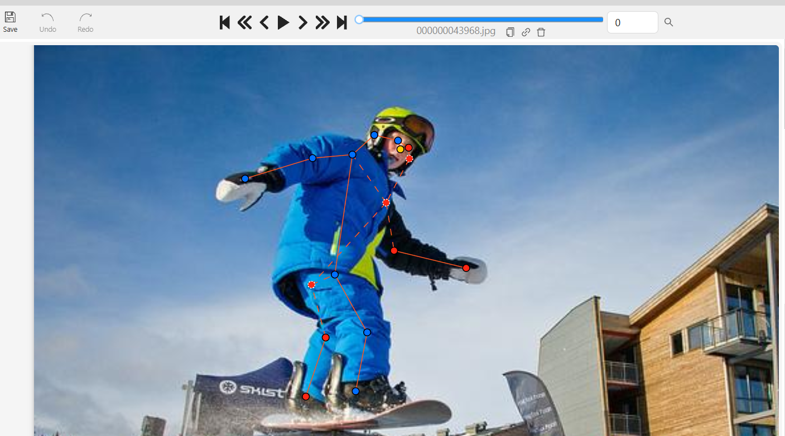
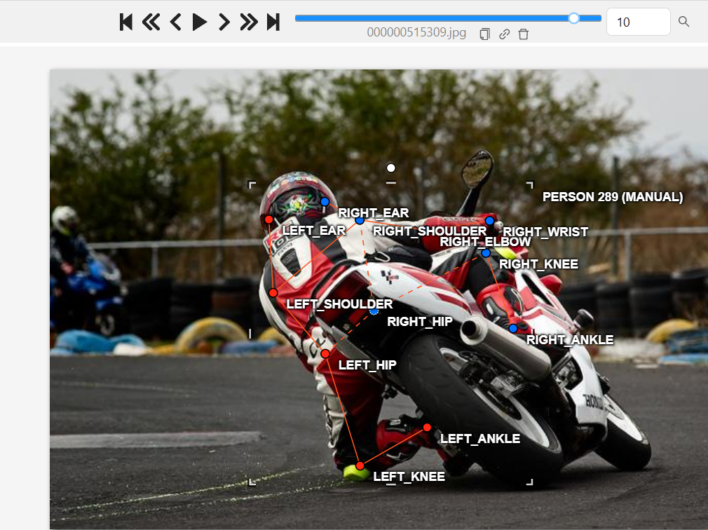
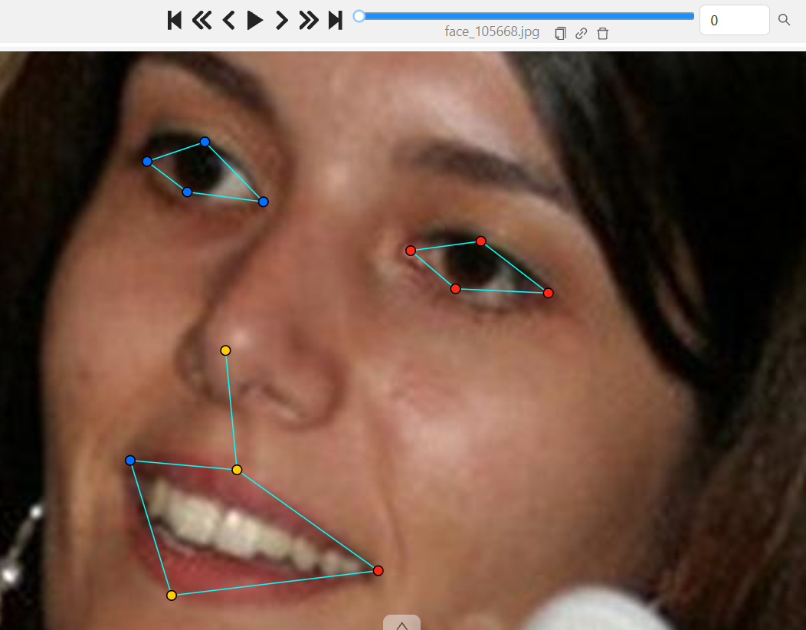
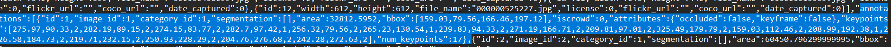

# Báo cáo cá nhân — NguyenQuocKhanh-2A202603238

Đổi tên file theo quy tắc `MSSV_HoTen.md`. Ví dụ: `20241234_NguyenVanAn.md`.

Dữ liệu: 12 ảnh người COCO val2017 (Lin et al., 2014) và 8 ảnh chân dung Wikimedia Commons, chỉ dùng trong lớp.

## 0. Thông tin học viên

- Họ tên: Nguyễn Quốc Khánh      
- MSSV: 2A202603238
- Email: 26ai.khanhnq3@vinuni.edu.vn
- Link repository: https://github.com/kanzh24/K5-L2A-DAY04-NguyenQuocKhanh-2A202603238-KeypointPose.git
- Phiên bản CVAT (Help → About): 2.82.1
- Máy: hệ điều hành Windows · RAM 16 GB · chạy CVAT chế độ đầy đủ / lite: chế độ đầy đủ
- Bộ ảnh (`src/exports/assignment.json` do `lab.py setup` tạo): có
- Giờ bắt đầu: 17:00 12/11/2026
- Giờ kết thúc: 20:30 12/11/2026

## 1. Kiểm tra label (CP0)

| Label | Kiểu | Số điểm | Tên điểm đúng bảng của lab? | Đúng thứ tự? | Số cạnh |
|---|---|---:|---|---|---:|
| `person` | skeleton | 17 | Đúng | Đúng | 19 |
| `face` | skeleton | 13 | Đúng | Đúng | 13 |

Mẫu `person` dựng theo người quay mặt về camera (các điểm `left_*` nằm bên phải khung mẫu)? Có / Không
-> Có

Cách đổi cờ `occluded` / `outside` cho **một điểm** trên phiên bản CVAT này (một câu):
Rê chuột vào điểm cần đổi trên skeleton rồi bấm phím `Q` để đổi thành `occluded` (v = 1), hoặc bấm phím `O` để đổi thành `outside` (v = 0), hoặc nhấp chuột phải vào điểm để chọn trạng thái trong menu ngữ cảnh.

## 2. Số lượng đã gán và thời gian (CP1, CP2)

| Nhóm ảnh | Số ảnh | Số skeleton đã gán | Số người dưới 60 px (không gán) | Số poster / gương / màn hình bỏ qua | Thời gian (phút) |
|---|---:|---:|---:|---:|---:|
| `easy` | 5 | 5 | 0 | 0 | 25 |
| `occluded` | 3 | 6 | 0 | 0 | 20 |
| `back` | 2 | 4 | 0 | 0 | 15 |
| `small` | 1 | 1 | 0 | 0 | 10 |
| `crowd` | 1 | 3 | 0 | 0 | 20 |
| `faces` | 8 | 8 | — | 0 | 25 |

- Số ảnh người đã xong ở mốc phút 105: 10 / 10
- Thời gian thực tế (phút): CP1 90 · CP2 25 · CP3 20
- Ảnh tốn thời gian nhất là ảnh nào, vì sao?
Ảnh `000000332273.jpg` (nhóm `crowd`) là ảnh tốn thời gian nhất vì có nhiều người đứng chen chúc, các bộ phận chân tay của các đối tượng đan xen và che khuất lẫn nhau, phải phóng to và dò theo từng chi (vai → khuỷu tay → cổ tay) để tránh gán nhầm sang người khác và xác định cờ occluded chính xác.

## 3. Bảng ca khó (CP1, CP2)

Mỗi điểm bạn phân vân một dòng, nhất là phân vân giữa `v = 1` và `v = 0`, hoặc không chắc hướng người.

| Ảnh | Người / mặt | Điểm | Cờ đã chọn | Phân vân giữa | Lý do chọn |
|---|---|---|---:|---|---|
| 000000069971.jpg | Người #1 (quay lưng) | `left_hip`, `left_knee`, `left_ankle` | 0 | v = 0 và v = 1 | Người quay lưng và phần thân dưới bị che khuất hoàn toàn sau vật cản, không thể ước lượng chắc chắn vị trí khớp nên chọn outside (v = 0) theo nguyên tắc không đoán bừa. |
| 000000056651.jpg | Người #2 (bị che) | `left_wrist` | 1 | v = 1 và v = 2 | Cổ tay bị che khuất một phần do hai tay bắt chéo trước thân, nhưng hướng của cẳng tay rất rõ ràng nên hoàn toàn ước lượng chắc chắn được vị trí khớp, chọn occluded (v = 1). |
| 000000515309.jpg | Người #2 (mép ảnh) | `right_elbow` | 2 | v = 2 và v = 0 | Khớp khuỷu tay phải nằm sát viền mép ảnh (x = 0.8) nhưng vẫn nhìn thấy được một phần mép tay trong ảnh, không bị cắt ra ngoài khung hình nên giữ nguyên v = 2. |
| face_53580.jpg | Mặt #1 | `left_eye_outer`, `mouth_left` | 1 | v = 1 và v = 0 | Khuôn mặt chụp góc hơi nghiêng và tóc che phủ một phần mắt/khóe miệng, nhưng dựa vào cấu trúc đối xứng khuôn mặt vẫn định vị rất tốt, chọn occluded (v = 1). |

## 4. Bảng tự review (CP3)

Đi từ ảnh cuối về ảnh đầu. 5 ảnh người (ít nhất 2 ảnh `back` hoặc `crowd`) và 3 ảnh mặt. Ít nhất 8 dòng, kể cả dòng `ok`. Ghi lỗi trước, sửa sau.

Mã lỗi dùng đúng một trong: `lr_swap`, `vis_flag`, `position`, `missing`, `extra`, `ok`.

| Ảnh | Người / mặt | Điểm | Mã lỗi | Ghi chú | Đã sửa? |
|---|---|---|---|---|---|
| 000000525227.jpg | Người #1 | `left_ear` | `vis_flag` | Tai trái bị tóc che một phần, lúc đầu để v=2 sau đó đổi sang occluded (v=1) | Có |
| 000000515309.jpg | Người #1 | Toàn bộ skeleton | `lr_swap` | Người quay lưng, lúc đầu các điểm left_* bị nhầm sang bên phải ảnh theo góc nhìn người xem, đã hoán đổi lại sang bên trái ảnh | Có |
| 000000438099.jpg | Người #1 | `left_knee`, `right_knee` | `vis_flag` | Chân bị che khuất ngoài khung hình, đổi từ v=1 sang v=0 (outside) để tránh đoán bừa | Có |
| 000000332273.jpg | Người #1, #2, #3 | Khớp vai, khuỷu tay | `position` | Cảnh đông người chen chúc, tinh chỉnh lại tâm khớp vai và khuỷu tay cho chuẩn khớp người | Có |
| 000000069971.jpg | Người #2 | Khớp mặt | `ok` | Đã kiểm tra đúng hướng quay lưng, các điểm mặt không thấy đã đặt outside đúng quy định | Có |
| face_483667.jpg | Mặt #1 | `left_eye_outer`, `left_eye_upper` | `vis_flag` | Mắt trái bị tóc che khuất nhẹ, cập nhật cờ thành occluded (v=1) | Có |
| face_256814.jpg | Mặt #1 | Các điểm mắt, mũi, miệng | `vis_flag` | Khuôn mặt bị che/kính râm tối, cập nhật đúng cờ occluded (v=1) | Có |
| face_10579.jpg | Mặt #1 | Toàn bộ 13 điểm | `ok` | Các điểm mí mắt, khóe mắt và viền môi chuẩn xác, đúng trái/phải | Có |

Tổng hợp số lỗi theo mã:

| `lr_swap` | `vis_flag` | `position` | `missing` | `extra` | `ok` |
|---:|---:|---:|---:|---:|---:|
| 1 | 4 | 1 | 0 | 0 | 2 |

Điểm còn phân vân giữa `v = 1` và `v = 0` (ghi cả hai lựa chọn và lý do chọn):

- Tại ảnh `000000069971.jpg` (người quay lưng #1): Các điểm chân và hông (`left_hip`, `left_knee`, `left_ankle`). Lựa chọn 1: Đặt `v = 1` nếu cố gắng ngoại suy dáng đứng. Lựa chọn 2: Đặt `v = 0` (`outside`) theo guideline khi phần thân dưới bị che khuất hoàn toàn và không thể định vị chính xác. Quyết định: Chọn `v = 0` để không làm bẩn dữ liệu huấn luyện và tránh bị phạt OKS do đoán bừa.
- Tại ảnh `000000438099.jpg` (người nhỏ #1): Các khớp chân sát mép dưới ảnh. Phân vân giữa `v = 1` (đoán chân đang đứng chạm đất) và `v = 0` (chân ra ngoài mép ảnh). Quyết định: Chọn `v = 0` vì khớp đã lọt ra ngoài mép khung hình.

## 5. Kiểm file xuất và kết quả tự kiểm (CP4)

Tự kiểm tay trong file JSON:

| File | Người / mặt kiểm (ảnh, thứ tự) | Số phần tử `keypoints` | Điểm `outside` ra `v = 0`, `occluded` ra `v = 1`? | `num_keypoints` khớp? |
|---|---|---:|---|---|
| `NguyenQuocKhanh_persons.zip` | 000000043968.jpg, người #1 | 51 | Đúng (3 điểm v=1, 0 điểm v=0) | Khớp (17) |
| `NguyenQuocKhanh_persons.zip` | 000000056651.jpg, người #1 | 51 | Đúng (6 điểm outside ra v=0, 5 điểm occluded ra v=1) | Khớp (11) |
| `NguyenQuocKhanh_faces.zip` | face_105668.jpg, mặt #1 | 39 | Đúng (0 điểm v=0, 0 điểm v=1, 13 điểm v=2) | Khớp (13) |

Sau khi xuất, CVAT ghi `occluded` thành `v = 1` và `outside` thành `v = 0`. Tọa độ của điểm `outside` trong file là `0, 0` hay tọa độ cũ? Tọa độ cũ (CVAT 2.x giữ lại tọa độ điểm trước khi bật outside, nhưng điểm có v = 0 sẽ bị mô hình và hàm tính OKS bỏ qua nên không ảnh hưởng).

Hai job đã chuyển sang completed trên CVAT? Có

Dán phần **TÓM TẮT** in ra từ `src/check_submission.py`:

```text
- File person: NguyenQuocKhanh_persons.zip
  Số ảnh: 12 · số skeleton `person`: 19 · mỗi annotation 51 số
  Skeleton theo ảnh: 000000043968=1, 000000056651=2, 000000069971=2, 000000091637=2, 000000156069=1, 000000188804=2, 000000225138=1, 000000261732=1, 000000332273=3, 000000438099=1, 000000515309=2, 000000525227=1
  Cờ v: v=2 223 (69%) · v=1 44 (14%) · v=0 56 (17%)
  num_keypoints trung bình: 14.1
- File face: NguyenQuocKhanh_faces.zip
  Số ảnh: 8 · số skeleton `face`: 8 · mỗi annotation 39 số
  Skeleton theo ảnh: face_105668=1, face_10579=1, face_256814=1, face_261458=1, face_345145=1, face_483667=1, face_53580=1, face_92028=1
  Cờ v: v=2 86 (83%) · v=1 18 (17%) · v=0 0 (0%)
  num_keypoints trung bình: 13.0
- Ghi chú: 56 điểm v = 0 vẫn mang tọa độ cũ (CVAT 2.x xuất như vậy; chuẩn COCO ghi 0, 0). Không phải lỗi: điểm v = 0 bị bỏ qua khi huấn luyện và khi chấm.
- Số [LỖI]: 0 · số [CẢNH BÁO]: 6
Kết quả: ĐẠT (đọc lại từng cảnh báo ở trên)
```

Các `[CẢNH BÁO]` còn giữ nguyên và lý do:

1. `000000043968.jpg #1`: Cặp hip, knee, ankle nằm ngược phía so với thân trên. Lý do giữ nguyên: Người trong ảnh đang ở tư thế vận động thể thao xoay vặn thân người, phần thân dưới xoay hướng khác so với trục vai, chân và hông bắt chéo thật chứ không phải lỗi đổi trái/phải (`lr_swap`).
2. `000000056651.jpg #2`: Cặp wrist nằm ngược phía. Lý do giữ nguyên: Đối tượng trong ảnh có tư thế khoanh/vắt hai tay bắt chéo trước ngực/bụng (cổ tay trái vắt qua bên phải và ngược lại), đây là tư thế thật của người.
3. `000000188804.jpg #1`: Cặp ankle nằm ngược phía. Lý do giữ nguyên: Người đang trong tư thế bước chân bắt chéo, hai cổ chân nằm chéo qua nhau trên mặt phẳng chiếu 2D của ảnh.
4. `000000225138.jpg #1`: Cặp ankle nằm ngược phía. Lý do giữ nguyên: Tư thế đứng bắt chéo chân tự nhiên của đối tượng.
5. `000000332273.jpg #1`: Cặp ankle nằm ngược phía. Lý do giữ nguyên: Người đang di chuyển/bước đi khiến hai chân bắt chéo nhau.
6. `000000515309.jpg #2`: `right_elbow` (v = 2) nằm sát mép ảnh (x = 0.8, y = 177). Lý do giữ nguyên: Người đứng ở sát viền bên trái của ảnh, khớp khuỷu tay phải vẫn nằm trong khung hình và nhìn thấy được (không phải khớp ngoài ảnh bị kéo về mép).

## 6. Ảnh chụp màn hình

1. Label `person` trong label constructor (đủ 17 điểm có tên):

   

2. Một người quay lưng đã gán, cờ đã đặt:

   

3. Một khuôn mặt đã gán 13 điểm, phóng to vùng mắt:

   

4. Một đoạn JSON xuất của một người:

   

Nguồn ảnh: COCO val2017 / Wikimedia Commons.

## 7. Tự đánh giá

1. Lỗi bạn mắc nhiều nhất hôm nay, và cách bạn sẽ tránh ở dự án thật:
   - Lỗi dễ mắc nhất là nhầm lẫn quy ước trái/phải (`lr_swap`) khi đối tượng quay lưng hoặc đứng ở các góc nghiêng phức tạp, và sự phân vân giữa cờ `v = 1` (occluded) và `v = 0` (outside) khi khớp bị che khuất.
   - Cách tránh trong dự án thật: Luôn tuân thủ nguyên tắc "nói to hướng của người trước khi kéo điểm", tự đặt mình vào góc nhìn của đối tượng (tay trái của người luôn là tay trái thật của họ); với người quay lưng, hoán đổi ngay các điểm `left_*` sang bên trái ảnh trước khi tinh chỉnh; kiểm tra kỹ đường nối xương (skeleton connections) xem có bị chéo bất thường không trước khi lưu.

2. Một quy tắc bạn đề xuất thêm vào guideline (kèm ảnh ví dụ nếu có):
   - Đề xuất bổ sung quy định rõ ràng và hình ảnh minh họa cho các trường hợp "tư thế vặn người / chân tay bắt chéo thật" (như vận động viên, người trượt ván, khoanh tay) để phân biệt rành mạch với cảnh báo `lr_swap`, kèm hướng dẫn cụ thể khi nào nên coi một khớp sát mép ảnh là `v = 2` (nhìn thấy được) thay vì bắt buộc chuyển thành `outside`.

3. Nhãn của bạn đi vào model ở đâu? Chọn một lỗi bạn đã sửa và nói nó sẽ làm model học sai thế nào (heatmap, trọng số trong loss, hay bước lật ảnh):
   - Nhãn đi vào mô hình qua 4 khâu chính:
     1. **Tạo Heatmap Gaussian đích:** Mỗi khớp có `v > 0` được biến đổi thành một đỉnh nhiệt Gauss tại tọa độ (x, y). Nếu nhãn lệch, đỉnh Gaussian lệch làm mô hình học sai vị trí tâm khớp.
     2. **Trọng số hàm Loss:** Điểm `v = 0` có trọng số 0 (không bị phạt), điểm `v = 1` và `v = 2` có trọng số 1 (mô hình bị ép phải học dự đoán cả khớp bị che).
     3. **Bước lật ảnh tăng cường (Horizontal Flip Data Augmentation):** Khi ảnh bị lật ngang, các nhãn `left_*` và `right_*` sẽ tự động tráo đổi cho nhau theo cặp.
     4. **Đánh giá OKS:** Chỉ các điểm `v > 0` trong nhãn mới được tính vào mẫu số và tử số của OKS.
   - **Phân tích lỗi đã sửa:** Lỗi tráo đổi trái/phải (`lr_swap`) trên người quay lưng (ảnh `000000515309.jpg`). Nếu để sót lỗi này:
     + Khi thực hiện bước lật ảnh tăng cường, code hoán đổi cặp `left_*` ↔ `right_*` sẽ biến nhãn sai thành một trạng thái mâu thuẫn hoàn toàn với giải phẫu học cơ thể người mà mô hình đang học.
     + Trên Heatmap, mô hình bị ép học đỉnh nhiệt của tay trái tại vị trí của tay phải và ngược lại, gây xung đột gradient cực lớn trong hàm loss.
     + Khi đánh giá kiểm thử, điểm OKS của người này sẽ sụp đổ về gần 0 do khoảng cách $d_i$ giữa khớp trái và khớp phải rất lớn so với hệ số dung sai $\sigma_i$.

## 8. Khó khăn và lỗi kỹ thuật

- Thao tác trên CVAT với nhiều điểm skeleton đòi hỏi phóng to/thu nhỏ liên tục; cần thời gian làm quen với các phím tắt chuyên dụng (`Q` cho occluded, `O` cho outside, `L` để khóa skeleton tránh kéo nhầm).
- Nhóm ảnh `crowd` (đông người chen chúc) và `occluded` (bị che lấp bởi xe cộ, đồ đạc) rất dễ gây nhầm lẫn đường nối xương giữa các đối tượng cạnh nhau nếu không lần theo tuần tự từng chi (vai → khuỷu tay → cổ tay).
- Việc phân định ranh giới giữa `v = 1` (ước lượng chắc chắn được) và `v = 0` (không chắc chắn, ngoài ảnh) cần sự nhất quán cao để không vô tình đưa nhiễu vào mô hình.

## Bonus (nếu làm)

*(Không làm bonus, đã hoàn thành đầy đủ toàn bộ CP0–CP4 của bài lab chính)*

## 9. Tài liệu tham khảo và công cụ AI đã dùng

- Bộ tài liệu hướng dẫn Lab Ngày 4: `docs/GUIDELINE.md`, `docs/COCO_KEYPOINTS.md`, `docs/CVAT_CHEATSHEET.md`.
- Chuẩn COCO Keypoints: Lin et al. (2014) *Microsoft COCO: Common Objects in Context*.
- Công cụ AI: Antigravity Assistant (hỗ trợ kiểm tra cú pháp Markdown, trích xuất dữ liệu tự kiểm từ script và đối chiếu quy chuẩn rubric).
